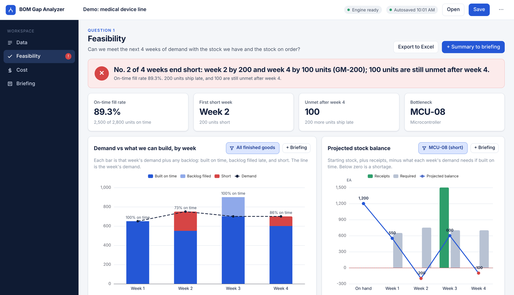
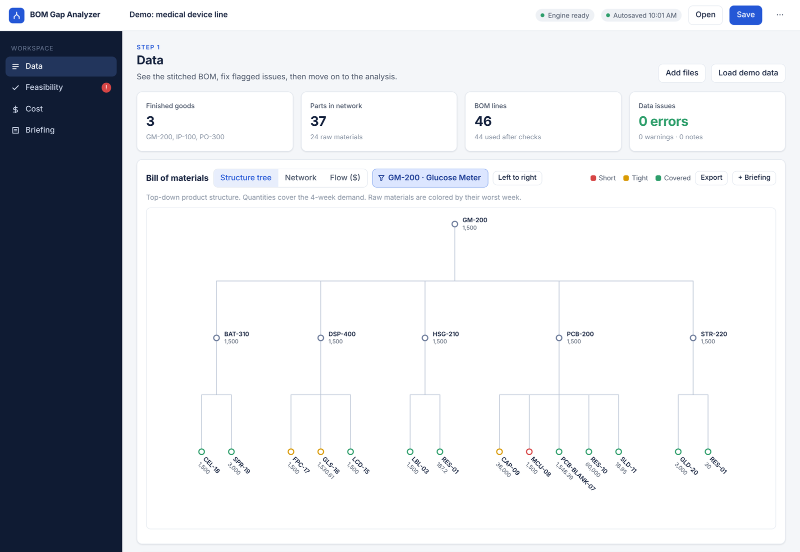
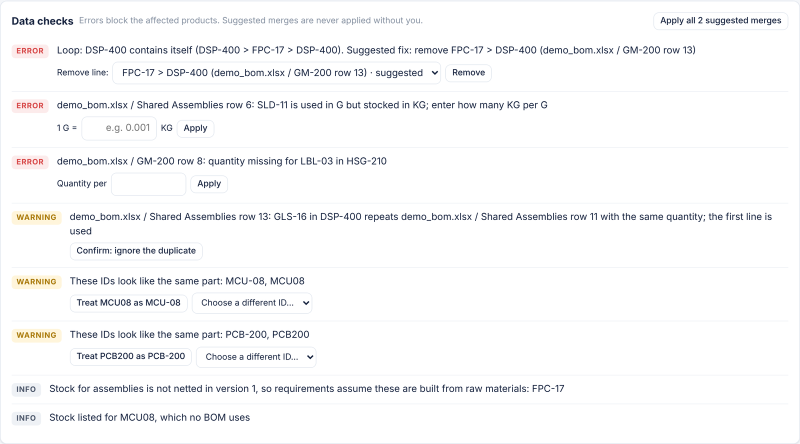
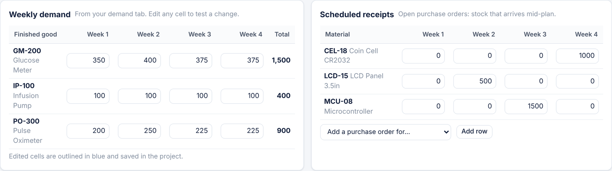
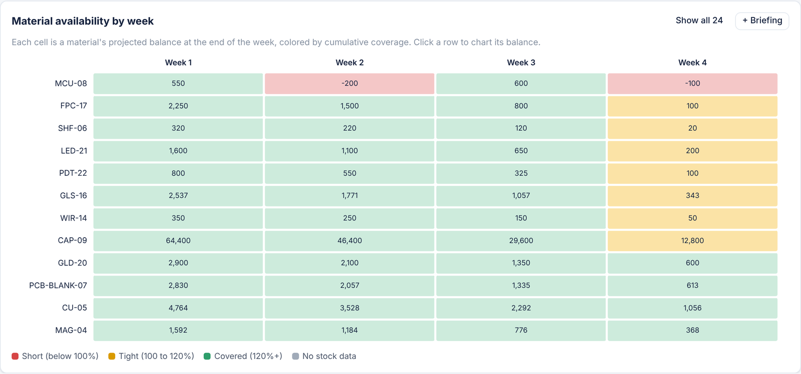
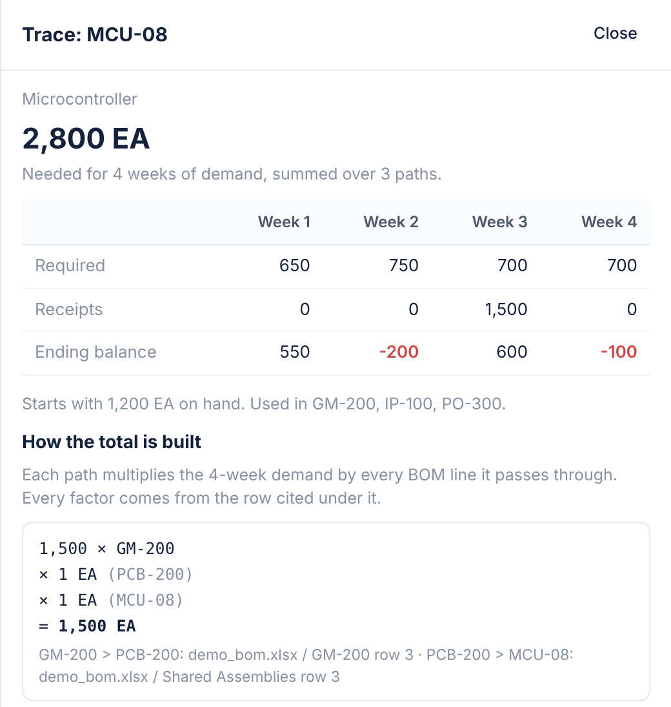
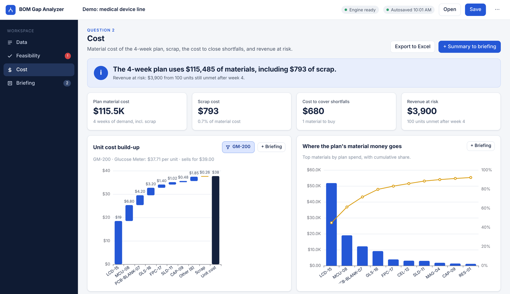
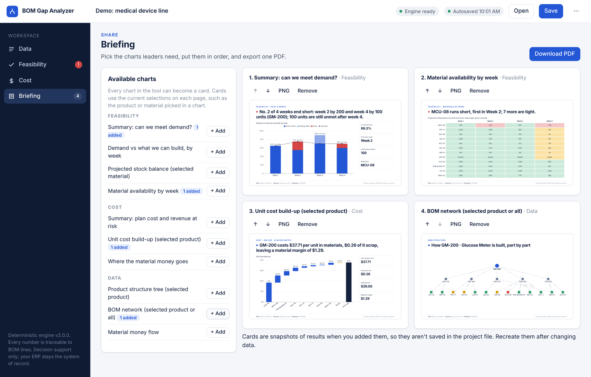
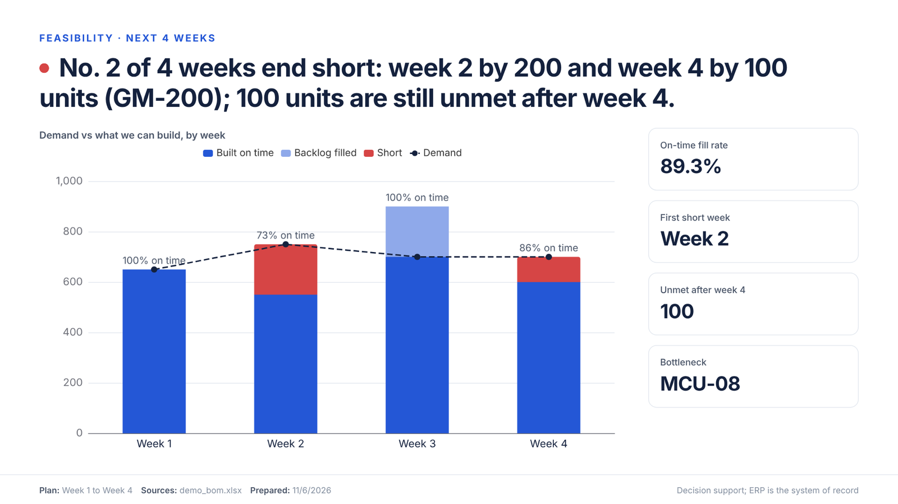

[← Back to portfolio home](/)

**[Python · Pyodide · NetworkX · SciPy · JavaScript · Claude]**

[Open the tool](/assets/css/bom-gap-analyzer.html) · <a href="/assets/css/bom-gap-analyzer.html" download>Download it</a> (single HTML file, opens in Chrome or Edge, no install)

## The problem

A bill of materials (BOM) lists everything it takes to make a product. A finished good breaks down into assemblies, the assemblies into components, and the components into raw materials. In most companies those layers live in separate Excel tabs and system exports, and each layer adds its own quantities, scrap rates, and unit changes.

Here is what usually happens. A planner is asked whether the plant can meet the next month of orders. The analyst opens the finished good's BOM, then VLOOKUPs each assembly into its own BOM, then each component into the next. Somewhere along the way solder paste is listed in grams but stocked in kilograms, a part number is written PCB200 in one tab and PCB-200 in another, and two products share a microcontroller that only gets counted once. Then comes the part a lookup can't handle: demand changes week to week, and a purchase order lands in week three. A total for the month says the plant is fine, while week two quietly runs out.

The pain continues after the first answer:

- **Rework.** Every new question ("what if that PO slips a week?") means rebuilding the lookups, because the spreadsheet holds one answer without the logic behind it.
- **Hidden errors.** Unit mismatches, missing quantities, and duplicate lines produce confident wrong numbers instead of visible errors.
- **Timing.** Monthly totals hide the week a material goes negative, and that week is when orders ship late.
- **Translation.** Leaders want "can we ship it, and what does it cost," and the analyst has to turn a workbook into a slide by hand.

None of these steps is hard alone. Together they make a routine planning question slow to answer and hard to trust.

## What the tool does

BOM Gap Analyzer is a single HTML file that a supply chain analyst opens in the browser and loads with BOM, stock, cost, weekly demand, and open purchase order exports. It answers two questions for the next four weeks: can we meet demand with the stock we have and the stock on order, and what does the plan cost? The calculation engine is Python running inside the browser, so every file stays on the analyst's computer and nothing is uploaded.

### Loading the data

- **Load and stitch.** Drop in any number of Excel files and tabs. The tool links separate BOMs into one network wherever a child part in one BOM is the parent in another, so the full chain from finished good to raw material assembles itself. It also reads SAP-style indented BOMs that use a level column.
- **See the BOM first.** The Data page opens with the stitched structure: a top-down product tree, an interactive network, or a flow of material dollars into each product. Column mapping is tucked into a collapsed section for when a guess needs checking.

- **Check the data before any math.** A data check flags loops (a part that contains itself), lines used in grams but stocked in kilograms with no conversion, missing quantities, duplicate lines, and look-alike part numbers. Each issue comes with a one-click fix, and every fix is listed so it can be undone.
- **Suggest, never merge silently.** Look-alike IDs such as MCU08 and MCU-08 are suggested as merges, but the analyst decides. A silent wrong merge would quietly change every number downstream.

### Planning the four weeks

- **A demand signal and open POs.** Weekly demand per finished good and scheduled receipts per raw material load from their own tabs, by week number or by date. Both can be edited in the tool to test a change, such as moving an order or adding a PO.

- **A week-by-week build.** Each week, the tool adds that week's receipts to the stock carried forward and builds as much of the week's demand as the stock allows. When stock is short, an exact integer optimizer builds the highest-value products first. Unmet demand carries into the next week as a backlog.
- **The whole horizon in one view.** A weekly chart shows demand against units built on time, backlog filled late, and units short. In the sample data, week two falls 200 glucose meters short, the week-three PO clears that backlog, and week four ends 100 units short.
- **When each material runs out.** A materials-by-week grid shows every material's projected balance at the end of each week, colored red when it goes negative and amber when it is tight. A balance chart for any one material shows starting stock, receipts, requirements, and the projected balance together.

- **Every number has a trace.** Clicking any material shows its weekly requirement, receipts, and balance, then the arithmetic behind its total, path by path, with the file and row of every BOM line used.

- **Cost.** Material cost rolls up per product with scrap shown separately, along with the cost to buy the shortfall after counting open POs and the revenue at risk from demand still unmet after week four. When costs are missing, the page names the exact parts and offers a table to fill them in.

### Sending the answer

- **Every chart can become a card.** Each chart has its own "+ Briefing" button that turns it into a 16:9 card with a one-line finding above the chart and its key numbers. The footer records the plan weeks and source files, and says the ERP remains the system of record.
- **Build the briefing.** The Briefing page lists every available chart, so the analyst can pick what a leader needs, put the cards in order, and export one PDF or individual images.
- **Excel exports.** Detail tables export at full precision for the analyst's own follow-up work.

Work autosaves in the browser, and a project file saves the inputs so the plan can be reopened or refreshed next week.

## How to think about it

The useful way to see this tool is as a decision-support instrument for one question asked many ways: given the BOMs, current stock, and the stock on order, can we meet the next four weeks of demand, what's stopping us, and what will it cost? It doesn't replace the ERP or the planner's judgment. A few principles shaped every decision.

**Plan in weeks, because that's how planning works.** The first version compared one plan against today's stock. Feedback from people in supply chain was that a static snapshot doesn't reflect how planning is done, so version 2 plans week by week against a demand signal, counts open purchase orders in the week they arrive, and carries shortages forward as backlog.

**Cut what people don't use.** Version 1 had separate Risk and Scenarios pages. The feedback showed little value in them, so both were removed, and the four-week plan now answers the "what if" questions directly: edit a week of demand or add a PO and every page recalculates. The cost view was found useful and stayed largely as it was.

**Make every number traceable.** In regulated industries such as pharma and medical devices, these figures feed production plans and inventory accounting. The trace view exists so any result can be checked by hand, down to the row it came from.

**Fail loudly on bad data.** A missing unit conversion blocks the calculation instead of defaulting to 1, and a loop stops everything until it's fixed. A wrong number that looks right is worse than no number, so errors are designed to be visible and specific.

**Keep the assumptions visible.** Version 2 assumes production happens in the week of demand, with no lead-time offset, and doesn't count stock of assemblies against requirements. Both are stated in the tool and are the next things to test with planners.

**No model at runtime.** There is no AI inside the tool. The same inputs always give the same answer, which matters for audited data and for getting a tool approved by IT. Python runs in the browser through Pyodide because the work is graph traversal and integer optimization, where NetworkX and SciPy are the right tools. AI was the collaborator that helped design, build, and review it.

## How to build something similar

I don't come from supply chain, and that shaped how I built this. My background is in analytics, where I know how to turn messy data into a trustworthy answer, so I treated the AI as both a domain guide and a developer. If you want to build a tool in a field you're still learning, this is the sequence I'd follow.

1. **Start with the problem and its audience.** I described the core problem (turning finished goods into raw material needs) and asked who uses the answer and what they ask for. Splitting analysts, who do the work, from leaders, who need the answer, shaped the whole design.
2. **Let the AI teach the domain, then check it.** I asked what supply chain leaders are used to seeing. The first suggestion was a Sankey diagram; when I pushed back, the answer changed to the formats planners already read, such as status grids and cost waterfalls. Ask the follow-up question.
3. **Write one purpose sentence and use it to cut scope.** The purpose sentence became the filter for every later idea, and it made the version 2 cuts easy to agree on.
4. **Write the design spec before any code.** Modules, required data, persistence, and exports were all decided in a shared document first, which made the build fast and the scope stable.
5. **Test with deliberately messy data.** The sample dataset includes a loop, a unit mismatch, a missing quantity, a duplicate line, look-alike part numbers, demand in one column per week, and POs in one row each. The answers were hand-checked, so the tests prove the math itself is right.
6. **Have a separate AI agent review the build.** An independent agent reviewed the first version against the spec and found 13 issues, including a performance problem at realistic BOM sizes and a rounding edge case that could flip a yes into a no. All were fixed and covered by tests.
7. **Put it in front of practitioners and act on what they say.** Their feedback reshaped version 2: a four-week plan with a demand signal and open POs, two pages removed, and briefing cards for every chart instead of one per page. Smaller notes, such as removing the arrows from number boxes and making filters easier to spot, mattered too.

You don't need to be a developer, or even an expert in the domain, to do this. You do need to know what a trustworthy answer looks like, ask the follow-up questions, and be willing to cut features when the people who'd use the tool say they don't need them.

## Try it for yourself

[Open BOM Gap Analyzer](/assets/css/bom-gap-analyzer.html) in Chrome or Edge, or <a href="/assets/css/bom-gap-analyzer.html" download>download the file</a> to run it from your desktop. Click **Load demo data** to start with a sample medical device line, or <a href="/assets/css/bom-demo-data.xlsx" download>download the sample workbook</a> to practice the upload step. The first open needs an internet connection to load the calculation engine. All part numbers, quantities, and prices in the sample are fictional.

[← Back to portfolio home](/)
