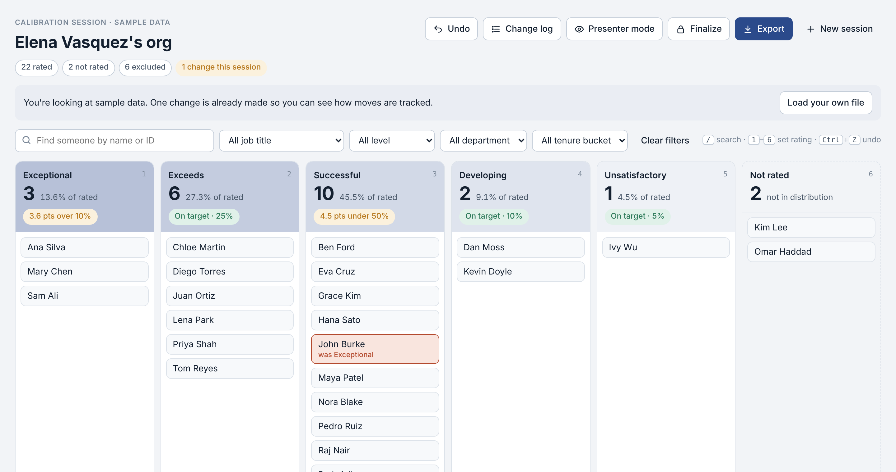
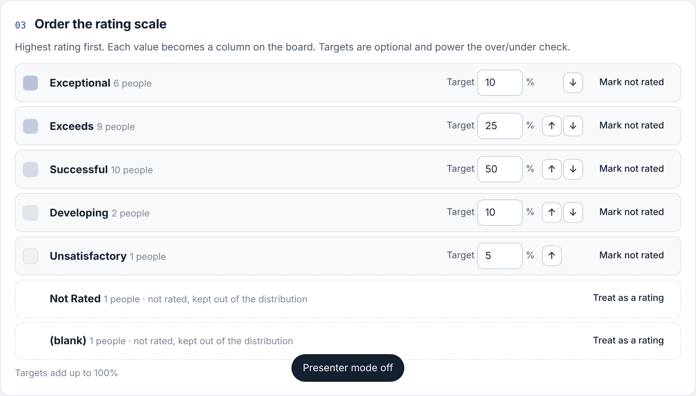
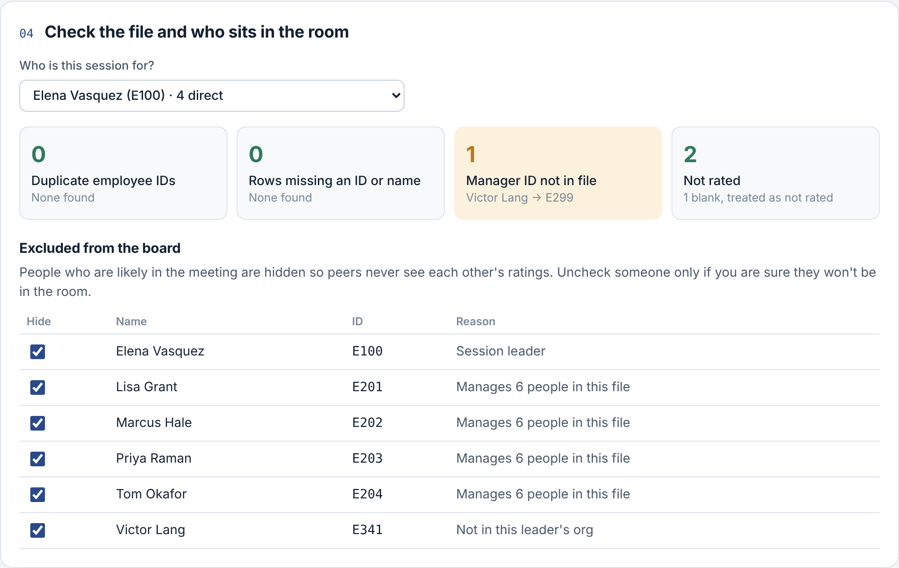
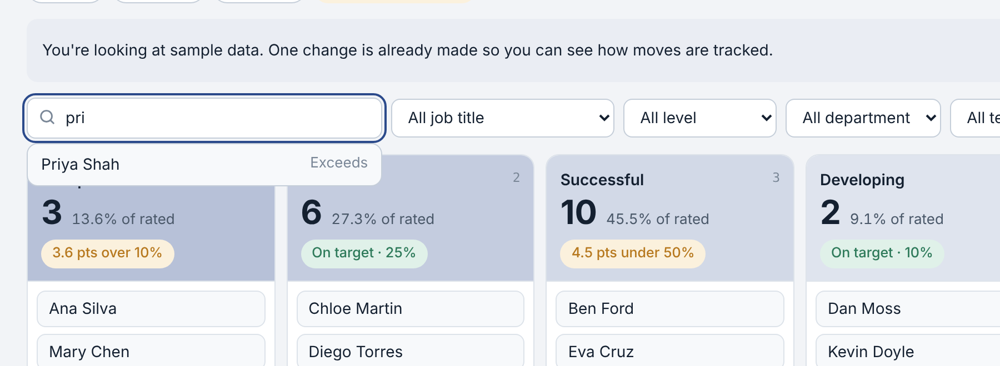
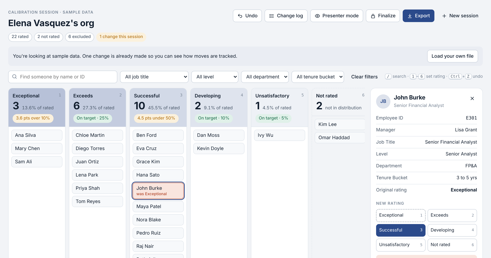
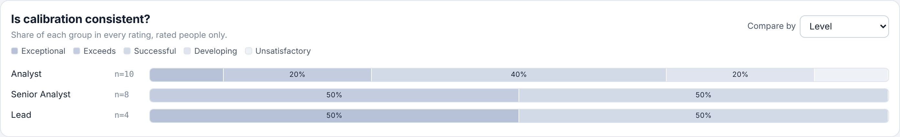
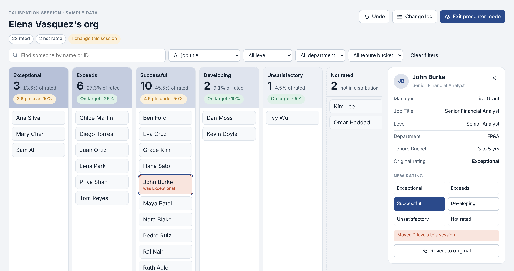
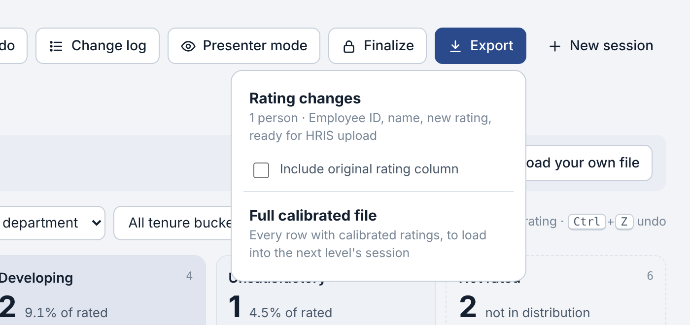

**[HTML · JavaScript · Claude]**

[Open the tool](/assets/css/calibration-board.html) · <a href="/assets/css/calibration-board.html" download>Download it</a> (single HTML file, opens in any browser, no install)

## The problem

Calibration meetings decide final performance ratings, and most of them still run on a spreadsheet shared on a screen. I sat in these meetings for years as an HR Business Partner, and the spreadsheet was never built for the moment it was being used in.

Here is what usually happens. The HRBP opens the ratings file, filters to the leader's team, and scrolls while the leaders talk. Someone asks how many people are in the top rating, and the HRBP stops to write a COUNTIF. A leader says John should move from top performer to middle, and the HRBP types over John's original rating. By the end of the hour, nobody can say with confidence which ratings changed, from what, or how far the final distribution drifted from the target.

The pain continues after the meeting:

- **Reconciliation.** The HRBP compares the edited file to a saved copy, or rebuilds the changes from memory and meeting notes.
- **Re-keying.** Changed ratings get copied into an upload template by hand before HR Operations can load them into the HRIS.
- **Privacy slips.** If the file isn't filtered carefully, managers sitting in the room can see each other's ratings on the shared screen.
- **Roll-ups.** Calibration runs in layers, manager sessions first and director sessions after, so every one of these steps repeats at each level.

Each step is manageable by itself, but together they make a high-stakes meeting depend on how fast and careful one person can be in Excel, in front of senior leaders.

## What the tool does

Calibration Board is a single HTML file that an HRBP opens in any browser, loads with the client group's ratings, and takes into the meeting. It turns the ratings file into a wall of columns, one per rating, and lets the HRBP move people live while leaders talk. All data stays on the HRBP's laptop; nothing is uploaded anywhere.

### Before the meeting

- **Load and match.** Drop in an Excel or CSV export. The tool guesses which columns hold Employee ID, name, Manager ID, and rating, and the HRBP confirms.
- **Build the scale from the file.** Every rating value in the file becomes a column, so a 3-point and a 5-point scale both work. Common scales (Exceeds/Meets/Below, 1 to 5) are ordered automatically, and the HRBP can reorder anything else. Optional target percentages power an over/under check.
- **Separate the not rated.** New hires and other ineligible employees go into their own Not rated bucket that is shown on the board but kept out of the distribution math.

- **Check the file.** A health check flags duplicate IDs, missing names, and Manager IDs that don't match anyone in the file.
- **Exclude the people in the room.** The HRBP picks who the session is for. Using the reporting tree built from Manager ID, the tool hides the session leader, anyone who manages people in the file, and anyone outside that leader's org. This runs even if the file was already filtered, as a second safety net.

### In the meeting

- **The board.** Each column shows names, a headcount, the percentage of rated employees, and whether it sits over or under target.
- **Find and change fast.** Type a name to jump to a person, then pick a new rating from the side panel or press a number key. Drag and drop works too, and Ctrl+Z undoes the last move.

- **Original and new stay separate.** The original rating never changes. Moved cards carry a "was Exceptional" tag, and moves of two or more levels get a stronger highlight because they tend to get questioned later.
- **Person card.** Clicking a name opens a snapshot with manager, level, tenure, department, and the original rating.

- **Consistency check.** A compare strip shows the rating mix by level, department, or tenure side by side, so leaders can see whether analysts are being rated on the same curve as leads.

- **Presenter mode.** One click hides employee IDs, exports, and exclusion details before the screen is shared.

### After the meeting

- **Finalize.** Locks every rating so nothing shifts after the conversation ends.
- **Export changes.** One click produces a CSV of only the people whose rating changed, with Employee ID, name, and new rating, ready for HR Operations to upload. Anyone moved back to their original rating drops out automatically.
- **Export the full file.** A second export carries every row with calibrated ratings, which becomes the input for the next level's session.

The session autosaves in the browser, so an accidental refresh mid-meeting loses nothing.

## How to think about it

The useful way to see this tool is as a meeting instrument. It doesn't replace the HRIS or the judgment of the leaders in the room. Its job is to keep one hour of high-stakes conversation running cleanly and to hand accurate data to the next step. A few principles shaped every decision.

**Design for the moment of use.** The tool is used live, with VPs watching, so speed beat flexibility. Search, number keys, and undo exist because fumbling with a mouse in front of leaders erodes trust. I also chose plain JavaScript over Python running in the browser because Python takes several seconds to load, and the logic here is simple enough that it gained nothing.

**Keep the record honest by design.** The original rating is never edited. The change list is calculated by comparing original to current, so it can't drift from what's on the board, and a person moved back to where they started stops counting as a change.

**Guardrails shouldn't depend on memory.** An HRBP running their sixth session of the week will eventually forget to filter out the managers. The exclusion check assumes that will happen and catches it anyway, using the reporting tree rather than trusting the file.

**Scope is a feature.** I left out per-change notes on purpose. In practice they either slow the HRBP down or turn into a generic picklist that adds little. Compensation modeling stayed out too, because calibration is one step in a longer cycle and this tool does that step well.

**No model at runtime.** There is no AI inside the tool. Every count and export is deterministic, which matters for HR data that may be audited and for getting a tool approved by IT and legal. AI was the collaborator that turned my process knowledge into working software.

## How to build something similar

I built this in one morning working with Claude, and I wrote very little code by hand. What made it work was the process knowledge, which is the part most HR and analytics people already have. If you want to build a tool for your own work, this is the sequence I'd follow.

1. **Start from a moment you've lived.** Pick one recurring situation that goes badly, and describe it as a scene: who is in the room, what they ask for, where things break. "An HRBP changing ratings live in front of leaders" is a much better starting point than "a compensation tool."
2. **Talk through the design before any code.** Describe the workflow in plain language and ask the AI to raise questions and propose features. Then answer as the practitioner. My answers did most of the shaping: the exclusion check, the not-rated bucket, and dropping notes all came from that back and forth.
3. **Ask for still mockups along the way.** A single picture of the board, then of the person card, let me react to layout and wording before anything was built. Reacting to a picture is faster than reacting to a spec.
4. **Define the output first.** Decide exactly what the tool must hand to the next person or system. Here that was a CSV with Employee ID, name, and new rating for HRIS upload, and everything else was designed backward from it.
5. **Write guardrails as assumptions about people.** "Assume the HRBP forgets to filter out the managers" is a requirement an AI can build against. "Make it secure" is not.
6. **Name what's out of scope.** Writing down "ratings only, no comp, no notes" kept the first version small enough to finish.
7. **Test with messy sample data.** The built-in sample includes a new hire with a blank rating, a person whose manager isn't in the file, and managers who should be hidden. Edge cases are where tools fail in real use, so put them in the test data on purpose.
8. **Put it in front of practitioners.** The next step is running real, anonymized calibration files through it with HRBPs and fixing what they trip on.

You don't need to be a developer to do this. You do need to know the work well enough to say what good looks like, and to keep saying no to features that don't serve the moment you started with.

## Try it for yourself

[Open Calibration Board](/assets/css/calibration-board.html) in your browser, or <a href="/assets/css/calibration-board.html" download>download the file</a> to run it from your desktop. It opens with sample data so you can try every feature before loading your own file. All names in the sample and screenshots are fictional.
