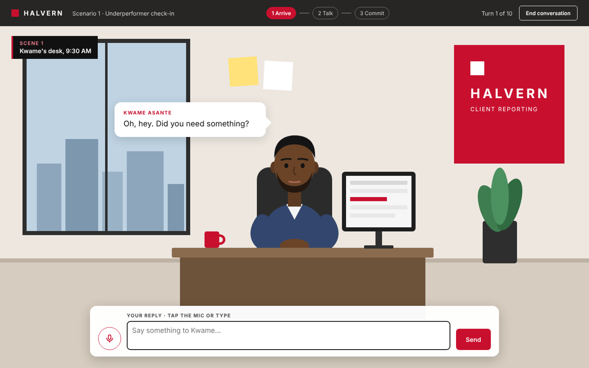
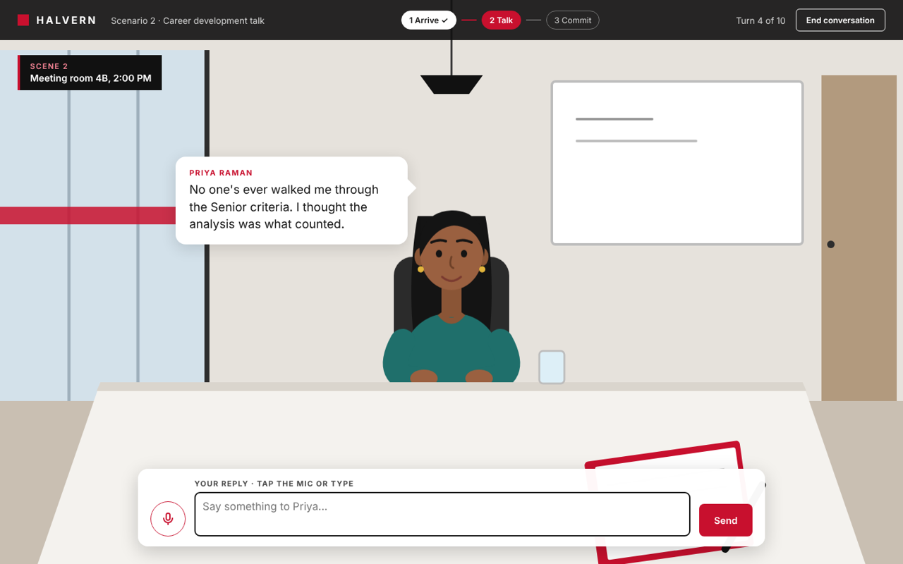
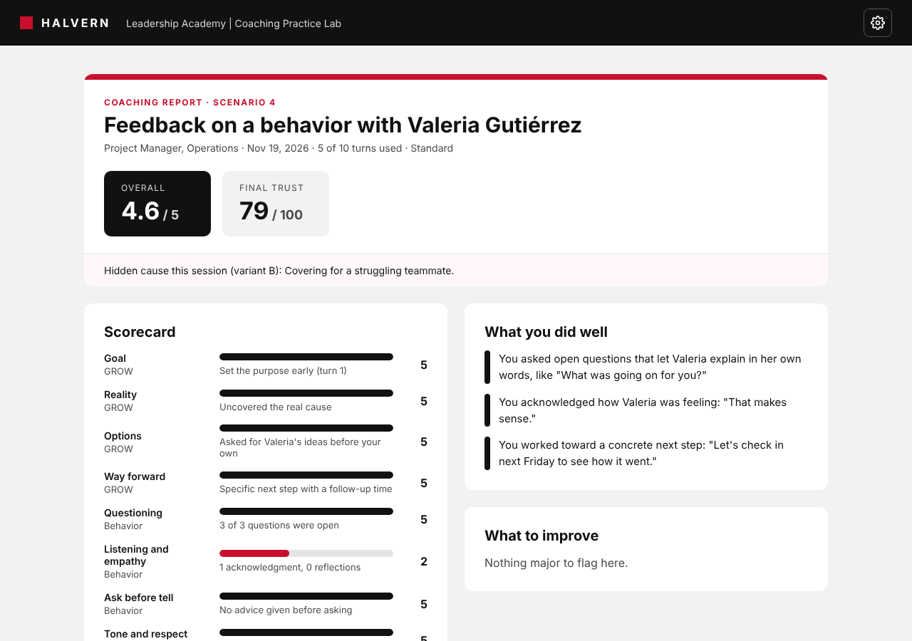

[← Back to home](/)

*Spoiler-light: this page explains how the simulator was designed and built. It doesn't list the hidden causes behind each scenario, so you can still discover them yourself.*

  <button class="cs-play" id="cs-play" aria-label="Open the Coaching Practice Lab here on the page">
    ▶ Try it here
    <small>Best in Chrome or Edge on a laptop. The first run downloads an AI model (about 1 to 2 GB) that then stays in your browser.</small>
  </button>

<a href="/assets/css/coaching-simulator.html" target="_blank" rel="noopener">Open full screen in a new tab</a> · <a href="/assets/css/coaching-simulator.html?mock=1" target="_blank" rel="noopener">Quick preview</a> (scripted replies, no download) · <a href="/assets/css/coaching-simulator.html" download>Download it</a> (single HTML file, no install)

## The Problem

Most manager training on coaching works the same way: a slide on the GROW model, a role-play with a colleague who knows the answer, and a multiple-choice quiz at the end. People learn to recognize good coaching, but they rarely practice saying it out loud, in their own words, to someone who reacts.

Static e-learning has a second weakness. Once a module has a right answer, people memorize it and click through, and the module stops teaching anything. In my years in HR, as an HR business partner and in people analytics, I watched managers walk into real performance and career conversations with plenty of theory and very little practice.

## The Solution

The Coaching Practice Lab is a browser-based simulator for managers. You choose a scenario, read a short briefing, and hold a free-form conversation with an AI employee, by voice or by typing. There is no script and no multiple choice. The employee responds to what you actually say, opens up when you coach well, and pulls back when you blame, lecture or threaten.

After 10 turns you get a scored feedback report. It quotes your own words back to you, shows stronger versions of your weakest lines, and reveals what you never managed to uncover.

## How It Works

**1. Starting with a spec, not code**
- Before anything was built, I worked through the requirements in a written spec: audience, scenarios, how the employee should behave, how scoring works and what the report includes.
- The key architecture decision was running the AI model inside the browser. Conversations never leave the user's computer, which matters for a tool where managers practice sensitive conversations.

**2. Getting the experience right before scaling**
- The first mockups were text chat screens. I rejected them as too bland. A simulator should feel like a scene, with a person on the other side.
- The redesign uses illustrated office scenes and an animated employee who breathes, blinks and changes expression. Each conversation moves through three scenes: Arrive, Talk and Commit.
- I had one scenario built end to end and tested it myself before approving the other three.

**3. Four scenarios, each with a hidden cause**

| Scenario | Employee | What the manager has to do |
|---|---|---|
| Underperformer check-in | Kwame Asante, Senior Analyst | Find out why a dependable analyst started missing deadlines, and agree on a plan |
| Career development talk | Priya Raman, Analyst II | Be honest about the gap to a promotion and help her own the next steps |
| Stuck high performer | Hiroshi Tanaka, Lead Engineer | Learn why a top engineer went quiet and turned down a stretch project |
| Feedback on a behavior | Valeria Gutiérrez, Project Manager | Give specific feedback about interrupting in meetings and agree on a change |

- Every scenario has three possible hidden causes, and one is picked at random each time you play. Retrying never repeats the last one, so the scenario can't be passed by memorizing answers.
- Briefings give managers only what they would really know going in. The rest has to be earned in the conversation.

**4. An employee who reacts to coaching**
- Each thing the manager says is classified: open or closed question, empathy, reflection, asking for ideas, advice, blame, threat or a next step.
- Those labels move a hidden trust level. Trust decides what the employee is willing to share: a vague answer at first, a hint as trust builds, and the real story only when it's high. It also drives the character's expression and posture, so managers can read body language as they would in a real 1:1.
- The AI model only plays the character. It never sees facts the manager hasn't unlocked yet, so it can't give them away too early.

**5. Scoring that is consistent and explainable**
- The report scores 8 areas from 1 to 5: the four GROW stages (Goal, Reality, Options, Way forward) and four coaching behaviors (Questioning, Listening and empathy, Ask before tell, Tone and respect).
- Scores are calculated by rules, not by the AI, so the same conversation always gets the same score. A full transcript at the end shows how each turn was counted and how it moved trust.

## Example Moments

**Moment 1: Same intent, different result**

A manager who opens with "You've missed two deadlines, so I need you to get back on track" gets a short, guarded reply. A manager who says "Missing deadlines isn't like you. What's been making things harder?" gets the start of the real story. The report shows both versions side by side when a line falls short.

**Moment 2: Advice at the wrong moment**

Building a plan is the right move near the end of a conversation, but handing over the plan isn't. When a manager lists the actions themselves, the report credits the goal and suggests asking first: "What do you think would help most over the next two weeks? I have a couple of ideas too, but I'd like to hear yours first."

**Moment 3: Feedback without the feedback**

In the feedback scenario, a manager can be warm and ask good questions and still never name the behavior. The report catches that and caps the Reality score, because a feedback conversation that avoids the feedback hasn't done its job.

## Results

- **A complete, playable simulator:** 4 scenarios, 12 hidden causes, 12 illustrated scenes and 4 animated characters, with voice or text input.
- **Private by design:** the AI model (Llama 3.2) runs in the browser through WebGPU. Nothing a manager says leaves their computer, and a cloud model is available only as a hidden, optional setting.
- **One file, no install:** a single HTML file. The model downloads once on first use and then loads from the browser.
- **A report people can act on:** scores with a reason for each, strengths and gaps quoted in the manager's own words, rewritten example lines, the hidden cause they missed, a full transcript and a PDF export.
- **Tested before every handoff:** an independent AI test agent played through every scenario in a real browser before each version reached me. Across two review rounds it found 33 issues, all fixed before my own testing.

## What I Learned

**Rules for scoring, AI for conversation.** My first plan had the AI grade the conversation too. Testing showed a small model labels things inconsistently and makes each turn slower. Moving the scoring to clear rules made reports consistent and explainable, and removed a second model call from every turn, which made replies noticeably faster. The model now does the one thing it does best: playing a believable person.

**Voice input changes everything downstream.** Spoken answers arrive as one long sentence with no question marks and plenty of "um." The first version missed questions asked out loud. My own test sessions surfaced this, and the scoring now handles unpunctuated speech, curly apostrophes and filler words.

**Fair scoring is in the details.** "Why don't we sit down and talk about it" was being scored as advice. "Feeling like you have to cover two jobs" was scored as telling someone what they have to do. Both came from my own test reports, and each one would have made a good manager distrust the tool. Reading my own transcripts the way a skeptical participant would was the most useful testing I did.

**HR judgment shapes the design.** I kept the employees diverse, kept the scenarios realistic for a corporate setting, and set rules so the report coaches instead of shames. For a real rollout I'd store scores only, never transcripts, and agree with HR and legal that results are for development, not performance reviews.

**Check the license, not just the model.** One model I first offered turned out to be licensed for research only, so I removed it before publishing. The remaining models allow business use.

**Directing AI works like directing a team.** Claude wrote the code. My part was the decisions that needed HR and audience judgment: the concept, the scenarios, the scoring rubric, the visual direction, what counts as fair, and the prioritized feedback from each test round.

## Tech Stack

JavaScript · HTML/CSS · WebLLM · WebGPU · Llama 3.2 · Web Speech API · SVG · Playwright · Claude

Built with Llama. Llama 3.2 is licensed under the Llama 3.2 Community License, Copyright © Meta Platforms, Inc. All Rights Reserved.

## What's Next

One possible direction, not a committed plan, is a corporate version that records results automatically. Scores could flow through the company's learning platform (xAPI) or a Power Automate flow into a database, so L&D teams can see whether managers' coaching skills improve across repeat attempts. It could also include scenarios written with HR business partners, such as a difficult performance rating conversation and a return-from-leave check-in.

[Try the Coaching Practice Lab](/assets/css/coaching-simulator.html) · [← Back to home](/)
