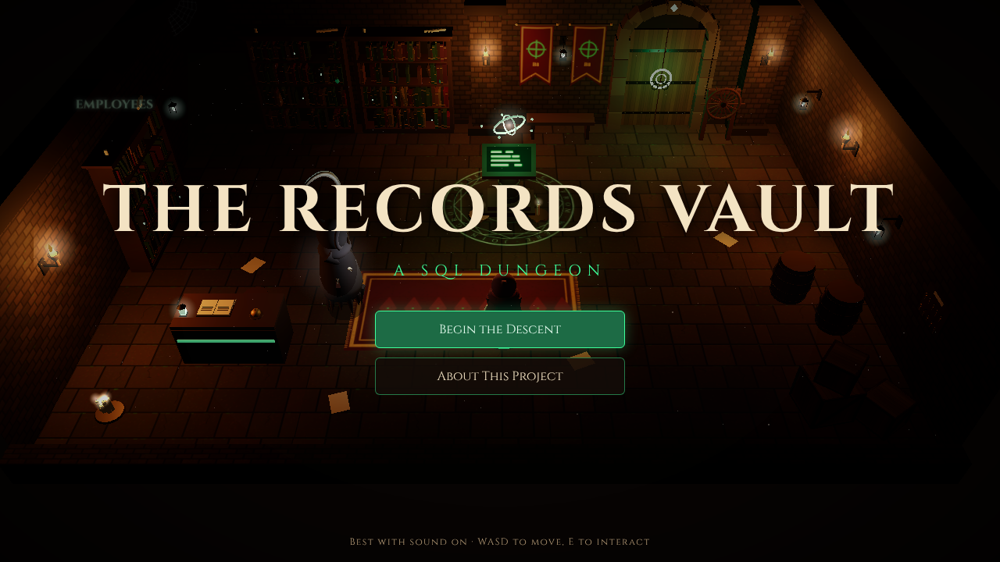
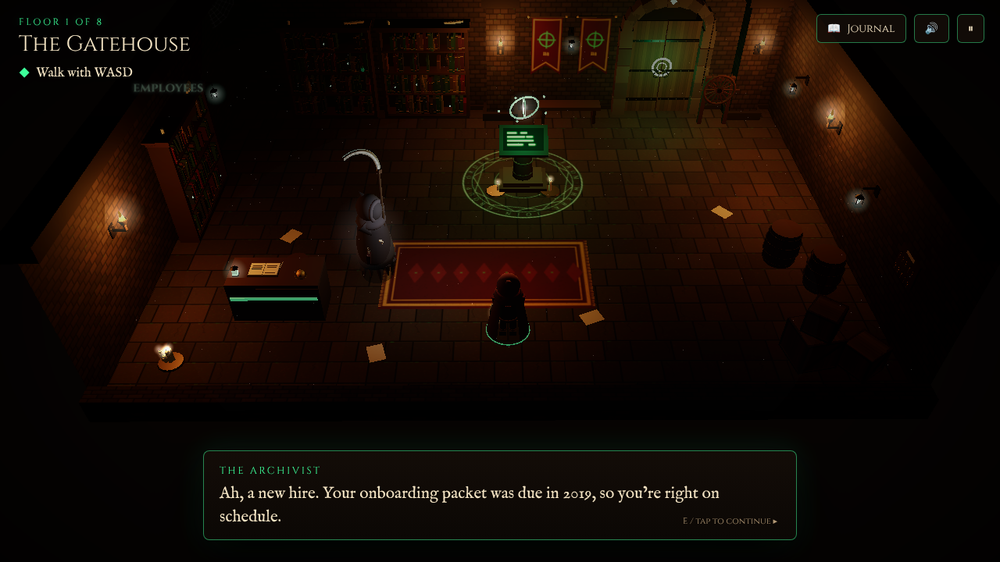

[← Back to home](/)

*Spoiler-free: this page covers how the game was designed and built. It leaves out the puzzle answers, the clues and the ending, so you can play it fresh.*

<style>
.rv-embed{position:relative;width:100%;aspect-ratio:16/9;min-height:420px;background:#0c0806 url('/assets/css/rv-01-title.png') center/cover no-repeat;border-radius:10px;overflow:hidden;box-shadow:0 6px 24px rgba(15,23,42,.25);margin:1.2rem 0 .5rem}
.rv-embed iframe{position:absolute;inset:0;width:100%;height:100%;border:0}
.rv-play{position:absolute;inset:0;display:flex;flex-direction:column;align-items:center;justify-content:center;gap:.5rem;background:rgba(12,8,6,.72);border:0;color:#f3e7cf;font:inherit;cursor:pointer;width:100%}
.rv-play span.rv-btn{background:#1f7a55;border:1px solid #4ade80;color:#fff;padding:.6rem 1.4rem;border-radius:6px;font-size:1.05rem;letter-spacing:.03em}
.rv-play:hover span.rv-btn{background:#238a60}
.rv-play small{opacity:.85;font-size:.85rem}
.rv-links{font-size:.92rem;margin-bottom:1.5rem}
@media (max-width:700px){.rv-embed{min-height:260px}}
</style>

<div class="rv-embed" id="rv-embed">
  <button class="rv-play" id="rv-play" aria-label="Play The Records Vault here on the page">
    <span class="rv-btn">▶ Play here</span>
    <small>Loads the game (about 2 MB). Click inside the game to use the keyboard.</small>
  </button>
</div>
<div class="rv-links"><a href="/assets/css/records-vault.html" target="_blank" rel="noopener">Open full screen in a new tab</a> (best on mobile) · <a href="/assets/css/records-vault.html" download>Download it</a> (single HTML file, no install) · Sound on recommended</div>

<script>
document.getElementById('rv-play').addEventListener('click', function () {
  var box = document.getElementById('rv-embed');
  var f = document.createElement('iframe');
  f.src = '/assets/css/records-vault.html';
  f.title = 'The Records Vault, a SQL dungeon game';
  f.allow = 'autoplay; fullscreen; clipboard-write';
  f.setAttribute('allowfullscreen', '');
  box.innerHTML = '';
  box.appendChild(f);
  f.addEventListener('load', function () { f.focus(); });
});
</script>

## The Problem

Most SQL practice looks the same: a blank editor, a sample database about orders or students, and a question with one right answer. It works for drilling syntax, but it rarely feels like real analytics work, and timed tests tend to push away the people who need the practice most.

I also had a portfolio problem. After 12 years in people analytics and HR operations, "advanced SQL" is one line on my résumé that a reader can skim past. I wanted something a recruiter or hiring manager could actually try, where the SQL is written by the player against data that looks like a real HR system, with the messy problems that come with one.

## The Solution

The Records Vault is a 3D dungeon game that runs in the browser. You play a new analyst on day one. Payroll and headcount don't agree, the quarterly audit is due Friday, and the answer is somewhere in the records vault eight floors underground. Each floor teaches a new set of SQL "spells," and every sealed door opens only when your query returns the right result from a fictional HRIS database.

It is the first game in a planned interactive résumé space, and the one I chose to build first because it reaches every audience I care about. Technical reviewers can judge the SQL, HR leaders recognize the data problems, and anyone can play.



## How It Works

**1. Starting from a question**
- I found an interactive portfolio built as a 3D game and asked how it was made. Inspecting the page source and network calls showed plain JavaScript, Three.js for the 3D scene and small Cloudflare functions for extras.
- That told me the architecture was within reach and could be hosted cheaply, which turned a "someday" idea into a project.

**2. Choosing the concept**
- I brainstormed five game ideas, kept three for the wider portfolio and started with the SQL Dungeon.
- The other two, Ask My Resume (GraphRAG on Neo4j) and a Merit Cycle Simulator, are planned next.

**3. Agreeing on the look before writing code**
- I asked for still images first. Three art directions were rendered from the same drawing code: chunky pixel art with green runes, warm candlelit stone with a parchment interface, and cold blue stone with cyan runes.
- I chose a hybrid of the candlelit warmth and the green accents, so interactive objects stand out against brown stone.
- The first drafts were a side-scrolling platformer. I moved the camera to a tilted overhead 3D view, since the target audience reads a polished 3D scene as more professional.

**4. Designing for learning instead of competition**
- The original plan had timers, scores and a leaderboard. I cut all of it, because a timed SQL test discourages beginners.
- The final game is solo and self-paced, with free tiered hints (a nudge first, then a query skeleton) and no penalty for wrong answers.
- I scored eight candidate mechanics against that goal and kept three: bookshelves that act as database tables, ghosts that are part of the data, and a case journal that doubles as a SQL notebook. Pressure plates, a dodge-the-boss fight and a separate practice mode were all dropped.

**5. A curriculum hidden inside the floors**

| Floor | Room | SQL skills |
|---|---|---|
| 1 | The Gatehouse | SELECT, WHERE, ORDER BY, LIMIT |
| 2 | The Armory | COUNT, GROUP BY, HAVING |
| 3 | Hall of Records | JOIN, LEFT JOIN, IS NULL |
| 4 | The Mirror Room | Self-joins with aliases |
| 5 | The Catacombs | Subqueries, NOT IN, EXISTS |
| 6 | The Clockwork Tower | CTEs (WITH), date math |
| 7 | The Hall of Ranks | Window functions, LAG |
| 8 | The Auditor's Hall | Recursive CTEs |

- Later spells stay sealed until you reach their floor, so the difficulty climbs in a fixed order.
- Each query also moves the story forward. What each floor uncovers is left for you to find.

**6. A dataset built to tell one story**
- The game runs on a synthetic HRIS with five tables: employees, departments, compensation history, payroll and requisitions. It is generated from a fixed seed, so every player sees identical data.
- The build runs 15 automated story checks before it produces the game, confirming that headcounts, payroll and pay history all line up with the plot. If any check fails, the build stops.

**7. Building, testing and playtesting**
- Automated Playwright scripts play the full game in a headless browser at desktop and phone sizes, including deliberate wrong answers, and screenshot every stage for review.
- I playtested the early floors myself and sent back specific, prioritized feedback, covered below.



## Example Moments

These show how the game teaches without giving anything away.

**Moment 1: A query written in another SQL dialect**

Many players learn SQL Server first. The game runs SQLite, so instead of a generic syntax error it recognizes common habits and explains the fix.

```sql
SELECT TOP 5 first_name, last_name
FROM employees;
```

**Game response:**

> TOP is SQL Server's way. Down here we speak SQLite: put LIMIT 5 at the very end instead.

It catches similar habits, such as `ISNULL()` instead of `IFNULL()`, `GETDATE()` instead of `date('now')`, and aggregates placed in WHERE instead of HAVING.

**Moment 2: A close but wrong answer**

A wrong result never gets a bare red X. The seal reports how close you are, for example the number of rows you returned against the number it expects, or that the rows are right but a column is missing. That turns a failed attempt into a clue about what to fix.

**Moment 3: Reaching for a spell too early**

If a player on Floor 1 tries a JOIN, the game replies that the spell is still sealed and names the floor where it unlocks. The player learns the order of the curriculum without hitting a wall.

## Results

- **A playable, complete game:** 8 floors, 10 SQL puzzles, a full story with a culprit to identify, and a certificate of completion players can share on LinkedIn.
- **Runs anywhere with no install:** one self-contained HTML file of about 2 MB that works on desktop and mobile, with a virtual joystick and tap-to-insert keyword chips on phones.
- **Safe by design:** each player gets a private copy of the database in the browser, only read-only queries are accepted, and no data leaves the device.
- **No answer key in the file:** correct results are stored as SHA-256 fingerprints, so a player can't read the answers from the source, and any query that returns the right rows passes regardless of column names or order.
- **Accessible:** settings for text size, reduced motion and sound, and verdicts that use icons and text rather than color alone.

## What I Learned

This project was as much about learning to design and direct a product as it was about building a game. A few lessons stood out.

**Playtesting beats planning.** Playing the first three floors showed problems no spec would have caught. Rooms felt too similar, so each floor got its own identity and props that react when you touch them. Jumping had no purpose, so crates and benches became climbable. A door looked open before its puzzle was solved, which turned out to be a real bug where door state carried over between floors.

**Domain knowledge shows up in small places.** The first version used a column called `status`. Players without an HR background didn't know what it meant, so it became `employment_status` with Active, On Leave and Terminated values. That change also made an early puzzle more realistic, since filtering for Active is different from excluding Terminated. A developer without HR experience would likely not have noticed.

**The data has to reconcile before anyone sees it.** The story only works if every number agrees with every other number. Writing automated checks for the dataset is the same discipline I use in people analytics reporting, and it caught inconsistencies early.

**Tone needs rules.** The humor is dry HR humor about process and bureaucracy. I set a firm rule that jokes never target layoffs, terminations, pay cuts, health or identity, because many players will be job seekers. One line was cut in review for crossing that line.

**Name the limits honestly.** I raised the risk that someone could read answers out of the file, which led to the hashed answers. Without a server, a determined player could still edit the code to skip ahead, so the certificate is described as honor-system until server verification is added.

**Directing AI works like directing a team.** Claude handled the implementation. My part was the decisions that needed audience and domain judgment: the concept, the visual direction, the cut from competitive to self-paced, the tone rules, the cheating risk and the playtest feedback. The workflow matched how I'd run an analytics product with developers: define the outcome, review early artifacts, test with real use and iterate on evidence.

## Tech Stack

Three.js · SQLite in WebAssembly (sql.js) · JavaScript · esbuild · Playwright · SHA-256 hashing · Claude

## What's Next

The next step is deploying on Cloudflare (Pages, Functions and D1, within the free tier) and issuing verified certificates through a server function, with a public page that proves completion. I also plan to add anonymous gameplay analytics, such as where players get stuck and which hints they use, shown in a final "analytics about this game" dashboard. After that come the next two portfolio games: Ask My Resume, a GraphRAG agent on Neo4j, and the Merit Cycle Simulator.

[Play The Records Vault](/assets/css/records-vault.html) · [← Back to home](/)
