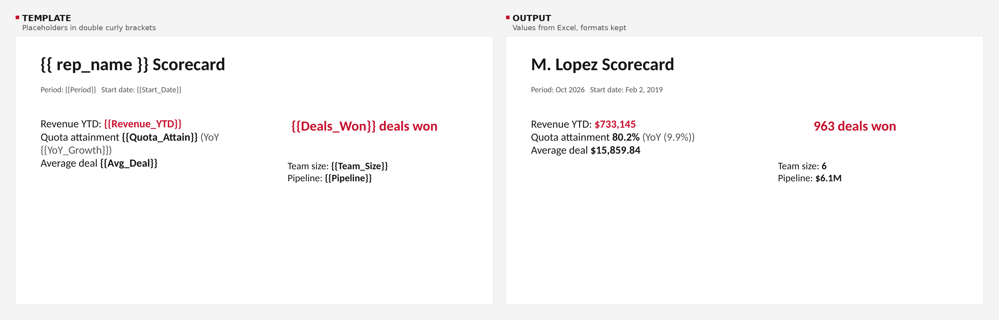
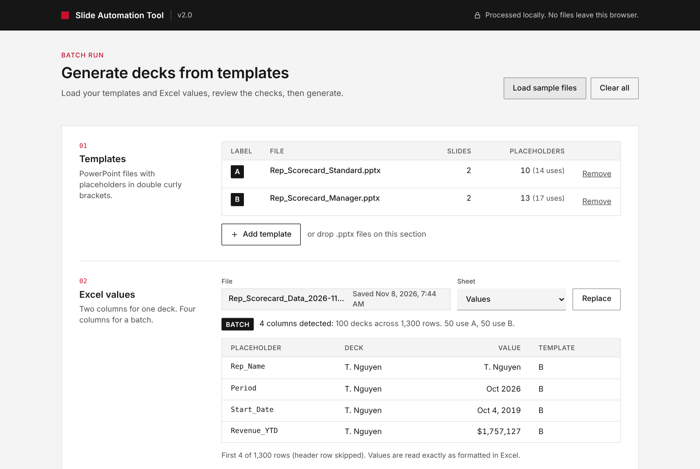
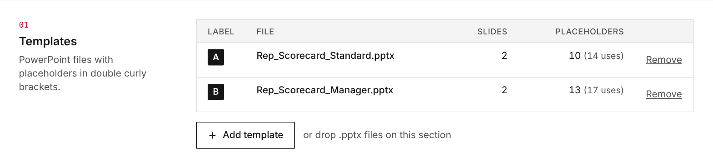
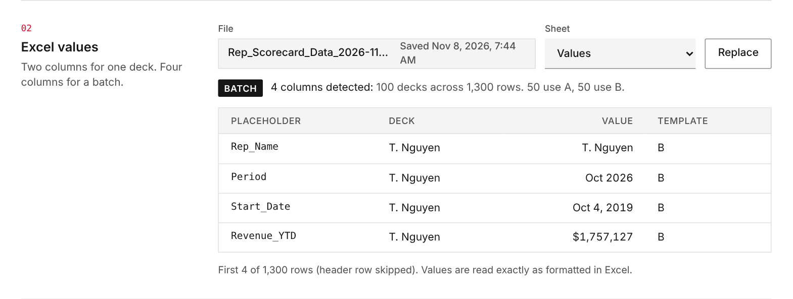
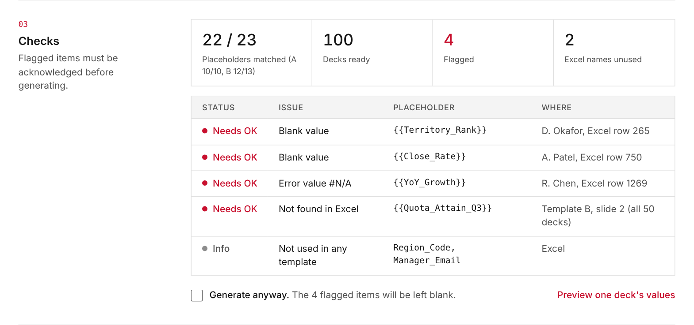
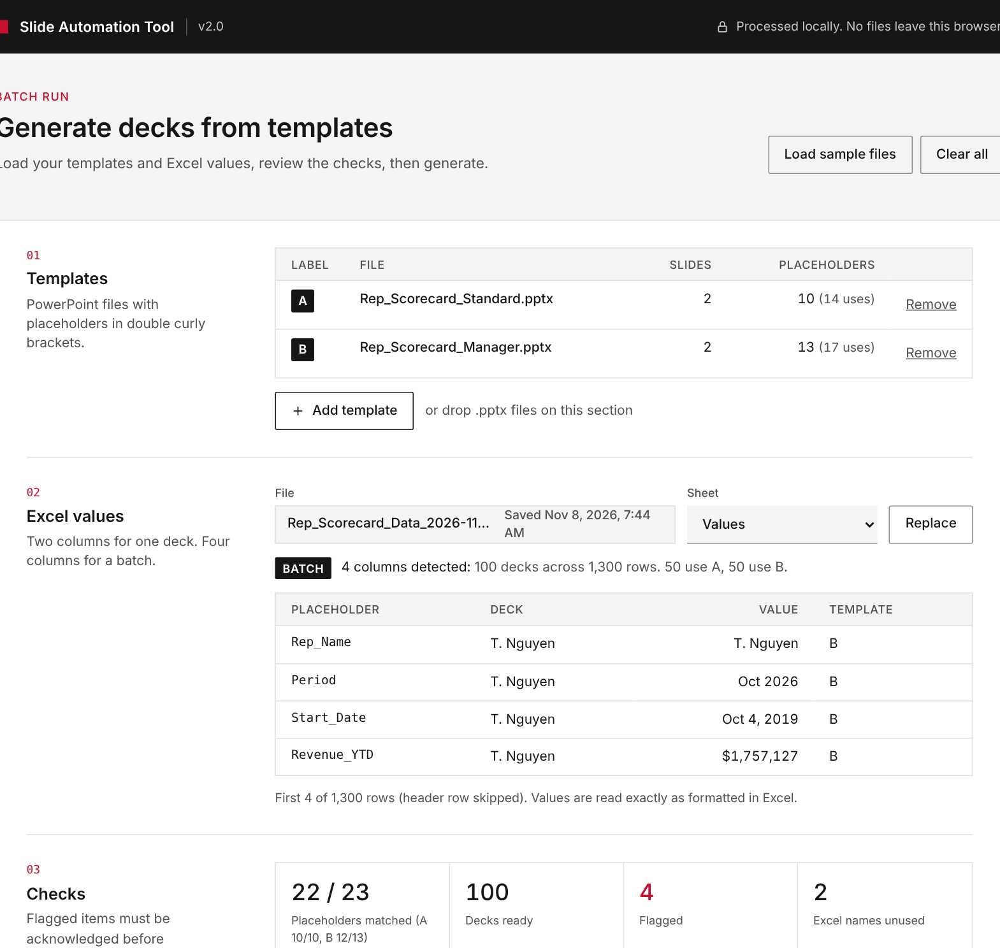
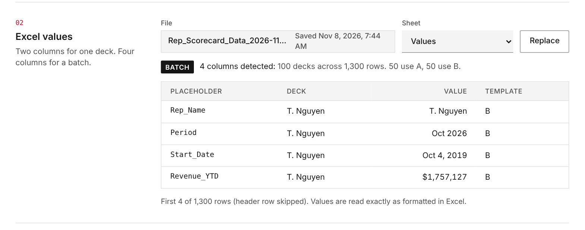



[← Back to portfolio home](/)

**[JavaScript · JSZip · SheetJS · Claude]**

[Open the tool](/assets/css/slide-automation-tool.html) · <a href="/assets/css/slide-automation-tool.html" download>Download it</a> (single HTML file, opens in Chrome or Edge, works offline, no install)

## The problem

Every month or quarter, someone in analytics updates the same deck. The numbers come from a model or a Power Query pipeline in Excel, and the slides already exist from last time. The analyst opens the deck, finds each number, copies the new value from Excel, pastes it in, and fixes the formatting that the paste broke. A 104.5% turns into 1.045, a currency value loses its dollar sign, and a negative growth rate shows a minus sign where the deck used parentheses.

It gets worse when the same deck goes to many people. I've seen this with sales rep scorecards, where 100 reps each needed their own two slides, and the reps were split across two different templates. Done by hand, that's 100 rounds of the same copy and paste.

The pain doesn't stop once the slides are filled in:

- **Errors are hard to spot.** One stale number on slide 2 of rep 63's deck is easy to miss and hard to find later.
- **Formatting drifts.** Pasted values pick up the wrong font, size or color, and the decks stop matching.
- **Blanks slip through.** If a value is missing in Excel, nothing tells you until someone notices an empty spot in a leader's deck.
- **It doesn't scale.** The work grows with every rep, region or business unit added to the list.

Each step is simple. Repeated across dozens of decks every cycle, they take hours and leave room for mistakes.

## What the tool does

Slide Automation Tool is a single HTML file. The analyst loads one or more PowerPoint templates with placeholders such as {{Revenue_YTD}}, plus an Excel file with the values. The tool checks the two against each other and produces finished decks with every placeholder replaced, keeping the number formatting exactly as it appears in Excel. Everything runs in the browser, so no file leaves the computer. Everything sits on one page, read top to bottom.

### Loading the files

- **Templates.** Any PowerPoint deck works as a template. Placeholders go in double curly brackets and can sit in text boxes, tables, grouped shapes or speaker notes. Each template gets a label (A, B, C), and the tool counts its slides and placeholders.

- **One deck: two columns.** For a single deck, the Excel file has a Placeholder column and a Value column.
- **Many decks: four columns.** For a batch, each row holds one value for one deck: Placeholder, Deck, Value and Template. The deck name and template repeat on every row for that deck. The file gets long (the 100 sample reps come to 1,300 rows), but that is exactly the shape a Power Query unpivot produces, so it is easy to keep refreshed.
- **Formats come from Excel.** The tool reads each value as Excel displays it, so 104.5%, $1,240,500, Oct 4, 2019 and (3.2%) all arrive on the slide as they look in the workbook.

### Checking before generating

- **Counts first.** A row of figures shows how many placeholders matched, how many decks are ready, how many items are flagged, and which Excel names no template uses.
- **Flags that need an OK.** Blank values, error values such as #N/A, and placeholders with no matching row in Excel are listed with the deck and Excel row. In the sample data, the tool flags two blanks, one #N/A, and a {{Quota_Attain_Q3}} placeholder that appears on template B but not in Excel. Generating is blocked until someone ticks "Generate anyway", and the flagged spots are then left blank.
- **Problems that must be fixed in Excel.** Some issues can't be safely guessed around: the same placeholder listed twice for one deck, a deck assigned to two different templates, or a template that isn't loaded. These stop the run until the Excel file is fixed.
- **Forgiving on small slips.** {{ rep_name }} and {{Rep_Name}} are treated as the same name, so a stray space or a lowercase letter doesn't break a match.

- **Preview a deck.** Before generating, any deck can be opened to see each placeholder next to the value it will get and the slides it appears on.

### Generating the decks

- **Separate files or combined.** A batch can come out as a zip with one deck per rep, or as one combined deck per template with every rep's slides in Excel order.
- **File names without typing.** The default name pattern is {Deck}_2026-11, which gives files like M_Lopez_2026-11.pptx. The pattern and the zip name can be edited before generating.
- **Fast.** The sample batch of 100 decks across two templates finishes in about a second.
- **Formatting stays with the slide.** PowerPoint often splits typed text into several pieces behind the scenes, so a placeholder can be stored as "{{Reve" and "nue_YTD}}". The tool joins those pieces before replacing, and the value keeps the font, size, color and bold of the template.

## How to think about it

The useful way to see this tool is as the last step of a reporting pipeline. Excel or Power Query produces the numbers and the template holds the design, while the tool joins the two the same way every time. It doesn't decide what goes on a slide.

**Fail loudly on bad data.** A blank or an #N/A in Excel is shown before generating, never quietly turned into an empty spot in a leader's deck. A number that looks right but isn't is worse than no number.

**Stay generic.** The tool remembers nothing between runs. A new template and a new Excel file work right away, so the same tool works for rep scorecards or any other recurring deck.

**One page, in order.** An earlier mockup split the work into three screens. It felt like too many places to go for a simple job, so everything moved onto one page: templates, Excel, checks, then Generate.

**JavaScript instead of Python.** The first version ran Python in the browser through Pyodide, which meant a 10 to 15 MB download and a pause before anything happened. This version is plain JavaScript in a 535 KB file that opens instantly and works offline. The Excel library also reads each cell's displayed text directly, which is what keeps the formats intact.

**Cut what users wouldn't use.** I considered direct cell links such as {{Summary!B4}}, a template scanner that writes the Excel file for you, and remembered settings. Analysts keep one Excel file and refresh it with Power Query, so those added complexity without solving a real problem.

**No model at runtime.** There is no AI inside the tool. The same files always give the same decks. AI helped me design, build and test it.

**Known limits.** Combined output is turned off for templates with charts or SmartArt, because those slides can't be copied safely. Chart data, images and slide masters aren't updated in this version. Ideas for later include coloring values against a target, up and down arrows by sign, and a file list that a Power Automate flow can use to email each rep their deck.

## How to build something similar

I had built a first version of this tool before, so this round started from what I already knew worked and what didn't. If you want to rebuild or improve a tool of your own with AI, this is the sequence I'd follow.

1. **Start by questioning the old design.** I asked whether Pyodide was still the right architecture and whether double curly brackets were the best placeholder style. The answers moved the tool to JavaScript and kept the brackets.
2. **Brainstorm, then cut hard.** The AI suggested several enhancements. I asked it to explain the reasoning behind each one, then kept only what matched how analysts actually work.
3. **Describe the data the way users will build it.** The batch layout went through a round of changes before landing on four long columns, because that's what a Power Query unpivot produces.
4. **Write the spec before any code.** Inputs, checks, outputs and the user flow were settled in a shared document first.
5. **Look at mockups before building.** Clickable mockups showed that three screens were too many and that the first color scheme looked flat. Both were fixed before a line of the real tool was written.
6. **Test against answers worked out separately.** A Python script built the sample files and calculated what every placeholder should show, independently of the tool. That comparison caught a real bug: the Excel library sometimes rounded 20.55% down to 20.5% where Excel shows 20.6%. After the fix, all 100 decks matched with no differences.

You don't need to be a developer to do this. You do need to know what a correct deck looks like and be willing to cut the features your users wouldn't use.

## Try it for yourself

[Open Slide Automation Tool](/assets/css/slide-automation-tool.html) in Chrome or Edge, or <a href="/assets/css/slide-automation-tool.html" download>download the file</a> to run it from your desktop. Click **Load sample files** to start with two rep scorecard templates and 100 reps, or <a href="/assets/css/slide-automation-sample-files.zip" download>download the sample files</a> to practice loading your own. The download includes a two-column file for a single deck and a three-column batch for one template. All names and numbers in the samples are fictional.

[← Back to portfolio home](/)

